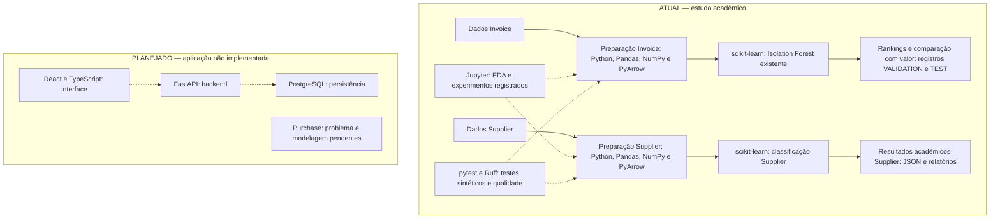

# Detector Inteligente de Anomalias em Compras

Projeto acadêmico de Machine Learning com três domínios independentes: anomalias em faturas, classificação de risco de fornecedores e risco de pedidos de compra. O Invoice possui um Isolation Forest treinado, avaliações históricas em VALIDATION e avaliação final única em TEST concluída. A avaliação final acadêmica Supplier Risk foi concluída, sem modelo de produção; seu TEST não será reutilizado. Backend e frontend ainda não estão implementados.

## Objetivo

O Invoice Anomaly Model prioriza faturas com comportamento incomum para auditoria humana, usando Isolation Forest; não classifica fraude automaticamente nem produz probabilidade de fraude. O Supplier Risk Model é uma classificação supervisionada de `Risk_Level`: estimar o pertencimento à classe de risco definida pelo dataset, não prever acontecimentos futuros. O Purchase mantém a fronteira pré-aprovação, mas ainda precisa escolher entre detecção de anomalias e previsão de um desfecho específico; sua fonte representa linhas de pedido.

As fontes representam populações diferentes, sem chaves reais comuns para integração. Não há merge direto entre suas features. Uma eventual integração de scores seria uma etapa conceitual futura, com validação própria. O Procurement KPI é somente auxiliar.

## Estado atual

| Domínio | Concluído | Pendente |
|---|---|---|
| Invoice Anomaly | 19 features, auditoria, triagem e comparação IF × valor em VALIDATION; avaliação final única em TEST concluída, com validação das fontes e sem fit | Procedência e utilidade humana limitadas; `source_reconciled=false`. Não repetir TEST |
| Supplier Risk | Preparação, EDA TRAIN, baselines/ablações, CV exploratória, configuração LR/C congelada e avaliação final única documentada | Procedência da label/índice, validade externa e eventual uso operacional; não reabrir TEST |
| Purchase Risk | Dataset analisado, granularidade da fonte em linha de pedido e fronteira pré-aprovação documentadas | Escolher anomalia ou desfecho específico; feature engineering, modelagem e avaliação |

A consolidação anterior de qualidade não executou treinamento, EDA nem reprocessamento dos dados reais. Em 16/09/2026 foi concluída a [primeira EDA Supplier, somente TRAIN](docs/supplier_risk_eda.md), sem alterar datasets ou treinar modelos. Posteriormente, a [primeira rodada de baselines](docs/supplier_risk_baseline_models.md) ajustou classificadores experimentais em TRAIN e comparou VALIDATION. A [validação científica exploratória](docs/supplier_risk_validation_analysis.md) acrescentou CV de cinco folds A/D dentro de TRAIN, controle negativo e reprodução diagnóstica da LR A. Esses experimentos não exportaram modelo final nem abriram TEST. O artefato Invoice existente não foi modificado.

## Tecnologias

Tecnologias utilizadas atualmente:

- Python
- Pandas
- NumPy
- Scikit-learn
- PyArrow
- Isolation Forest
- pytest e Ruff (desenvolvimento)

Tecnologias planejadas para etapas posteriores:

- FastAPI
- PostgreSQL
- React
- TypeScript

O backend, o banco de dados e o frontend ainda não fazem parte da implementação atual.

## Diagrama de Tecnologias

Os caminhos de Invoice e Supplier usam fontes separadas. O diagrama resume as tecnologias do estudo acadêmico; não representa um serviço em produção nem uma instrução para repetir os experimentos.



Python executa os scripts; Pandas e NumPy apoiam a preparação tabular e os cálculos; PyArrow permite trabalhar com Parquet. Scikit-learn fornece os estimadores e transformações. Jupyter reúne as análises acadêmicas, enquanto pytest e Ruff verificam o código, sem representar etapas de avaliação científica. As setas pontilhadas indicam apoio técnico ou relações planejadas.

Invoice concluiu a comparação em VALIDATION e a avaliação final em TEST. Supplier já concluiu sua avaliação final, sem modelo de produção. Purchase ainda não possui pipeline de modelagem. FastAPI, PostgreSQL, React e TypeScript pertencem à evolução descrita no [roadmap](docs/implementation_roadmap.md); a integração com os modelos depende de contratos futuros. Procurement KPI permanece auxiliar e não entra nos fluxos de treinamento.

## Materiais acadêmicos

Os [requisitos funcionais e não funcionais](docs/requisitos.md) consolidam funcionalidades existentes e extensões planejadas. Os benchmarks experimentais permanecem nos relatórios de cada domínio:

- **Supplier Risk:** [comparação com baseline majoritária, Logistic Regression, Random Forest e ablações](docs/supplier_risk_baseline_models.md), complementada pela [avaliação final já concluída](docs/supplier_risk_final_evaluation.md).
- **Invoice:** [comparação histórica do Isolation Forest com priorização por valor](docs/invoice_value_comparison_results.md), segundo o [protocolo histórico](docs/invoice_value_comparison_protocol.md), exclusivamente em VALIDATION; a [avaliação final em TEST](ml/experiments/invoice_test_final_v1.json) tem registro separado.

Esses benchmarks comparam abordagens de ML, não produtos comerciais. Métricas de domínios diferentes não são diretamente comparáveis; resultados e limitações ficam nos relatórios originais, sem duplicação aqui.

## Machine Learning

O Invoice utiliza Isolation Forest, um algoritmo não supervisionado para detecção de anomalias. Seus labels não entram como features; `is_fraud` é reservado à avaliação e `fraud_type` às análises complementares. Modelo e metadata já existem em `ml/models/` no ambiente com os dados locais.

Para evitar data leakage entre partições, campos derivados do risco conhecido (`supplier_risk_score` e `blacklisted_flag`), labels e explicações não entram nas features. As estatísticas de fornecedores, departamentos, países e relações fornecedor/departamento são calculadas exclusivamente no conjunto de treino, mas **não são ponto-a-ponto temporais dentro do TRAIN**: usam todo o período de treino, inclusive a própria observação.

`contamination=0.22` é configuração inicial, não desempenho comprovado. A avaliação consolidada e por `fraud_type` em VALIDATION está registrada em docs/invoice_validation_results.md. A amostra incluiu apenas fornecedores já observados no TRAIN. A avaliação final em TEST foi concluída separadamente, com o modelo existente e sem novo fit.

O ranking retrospectivo usa orçamentos fixos e não exige selecionar threshold operacional. Se um threshold operacional for necessário futuramente, sua escolha exigirá protocolo em validação, nunca em TEST.

No Supplier Risk, `Risk_Level` é o **target supervisionado**, nunca uma feature. A convenção adotada no projeto é `0 = menor risco`, `1 = maior risco`. Para modelos compatíveis, a saída poderá incluir a **probabilidade estimada de pertencimento à classe de risco**, não a probabilidade real de ocorrer um problema. A origem/regra da label não foi comprovada; resultados deverão ser interpretados como capacidade de reproduzir padrões associados à classificação fornecida pelo dataset. Ver [objetivo e limitações](docs/supplier_risk_model.md).

## Dataset principal

O **Procurement Invoice Fraud Dataset** contém 300.000 faturas, divididas oficialmente em:

- 210.000 registros de treino
- 30.000 registros de validação
- 60.000 registros de teste

Os dados brutos e processados não são armazenados no GitHub.

## Dataset auxiliar

O **Procurement KPI Analysis Dataset** contém 777 pedidos de compra e permanece apenas como fonte auxiliar: referência complementar, exploração futura de KPIs e possível apoio ao dashboard. Nesta fase, não participa do treinamento do Invoice Anomaly Model, Supplier Risk Model ou Purchase Risk Model. O arquivo local é preservado em `data/auxiliary/dataset_auxiliar_kpi_compras.csv`. A responsabilidade de cada fonte está descrita em [Estratégia de Dados](docs/data_strategy.md).

## Instalação

**IMPLEMENTADO — instalação limpa validada em Windows x64 / Python 3.14.3 em 2026-09-16.** A versão de Python permanece registrada em `.python-version`, presente, versionado e não ignorado. Nenhuma outra versão de Python foi declarada suportada.

A correção foi restrita a **pandas 2.2.2 → 2.3.3** em `requirements.txt`; as outras 21 versões fixadas foram mantidas e `requirements-dev.txt` não mudou. A escolha é sustentada pelo [suporte a Python 3.14 documentado pelo pandas 2.3.3](https://pandas.pydata.org/docs/whatsnew/v2.3.3.html), sem migrar para pandas 3.x. Matplotlib e ferramentas Jupyter ficam no [manifesto opcional de EDA Supplier](ml/supplier_risk/notebooks/requirements.txt), sem ampliar as dependências dos pipelines ou da CI. XGBoost permanece ausente.

### Instalação em um checkout novo

Confirmar que o executável escolhido é Python 3.14.3 antes dos comandos abaixo. `.python-version` não troca automaticamente o interpretador. O launcher pode selecionar outra versão instalada; conferir o executável efetivo, sem depender de um caminho pessoal.

```powershell
python -c "import sys; assert sys.version_info[:3] == (3, 14, 3), sys.version"
if ($LASTEXITCODE -ne 0) { throw "Selecione o Python 3.14.3 antes de continuar." }
if (Test-Path -LiteralPath .venv) { throw "A .venv já existe; preserve-a e use outro local novo." }
python -I -m venv .venv
if ($LASTEXITCODE -ne 0) { throw "Falha ao criar o ambiente isolado." }
.\.venv\Scripts\python.exe -I -m pip --isolated install --only-binary=:all: --index-url https://pypi.org/simple --no-cache-dir --disable-pip-version-check -r requirements-dev.txt
if ($LASTEXITCODE -ne 0) { throw "Falha na instalação das dependências." }
.\.venv\Scripts\python.exe -I -m pip check
```

Não utilizar `--system-site-packages`. A instalação foi comprovada usando wheels do PyPI e pip 25.3, sem cache, em venv nova com `include-system-site-packages=false`. Foi verificado que os pacotes instalados pertencem à venv, que o user-site está desabilitado e que `pip check` não identifica conflitos. Os 113 testes sintéticos e o Ruff passaram nesse ambiente.

**Ambiente principal preservado — conferência em 14/10/2026:** a `.venv` existente usa Python 3.14.3 e pandas 2.3.3, conforme os requisitos atuais, mas mantém `include-system-site-packages=true` e depende de pacotes do user-site. As versões coincidem com os pins quando esses pacotes externos estão disponíveis; isso não comprova isolamento. As referências a pandas 2.2.2 na tabela abaixo descrevem o ambiente histórico de setembro, não o estado vigente. Preserve essa `.venv` e use um ambiente novo e isolado para validação, sem instalar sobre o ambiente legado automaticamente.

### Combinações verificadas e histórico

| Interpretador / ambiente | Verificação | Resultado / limite |
|---|---|---|
| Python 3.14.3, Windows x64, venv nova e isolada, pandas 2.3.3 e demais pins atuais | Instalação completa por wheels, isolamento, pip check, Ruff e pytest | **Aprovado em 2026-09-16: 113 testes**, sem datasets externos |
| Registro histórico de setembro/2026: Python 3.14.3 na `.venv` principal antiga, pandas 2.2.2 | Pins anteriores, pip check e suíte sintética | Funcional naquele registro, mas reutilizava pacotes externos; não descreve o ambiente vigente nem uma instalação limpa |
| Python 3.14.3 em venv temporária com os requisitos antigos | Resolução limpa por wheels em 14–15/09/2026 | Falhou em pandas 2.2.2; combinação substituída |
| Python 3.13.14 em venv temporária com os requisitos antigos | Mesma sondagem de resolução por wheels | Falhou em pandas 2.2.2; requisitos atuais e suíte não testados nessa versão |
| Python 3.14.4 registrado no launcher | Somente versão/executável consultados | Projeto não validado nessa versão |
| Linux, macOS, Python free-threaded, compilação a partir da fonte | Não testados | Nenhuma alegação de compatibilidade |

As **22 versões fixadas** para a nova instalação são:

- execução: pandas 2.3.3, numpy 2.5.2, pyarrow 25.0.1, scikit-learn 1.9.0, joblib 1.6.0, openpyxl 3.1.5;
- transitivas de execução: python-dateutil 2.9.0.post0, pytz 2026.2, tzdata 2025.3, six 1.17.0, et-xmlfile 2.0.0, scipy 1.18.1, threadpoolctl 3.6.0, narwhals 2.21.2, cloudpickle 3.1.2;
- desenvolvimento: pytest 9.1.1, ruff 0.16.5, colorama 0.4.6 (Windows), iniconfig 2.3.0, packaging 26.0, pluggy 1.6.0, pygments 2.20.0.

**Registro histórico:** em 2026-09-14, `git status` indicava exclusão local de `.python-version`; `git ls-files` confirmou o versionamento e `git check-ignore -v` não identificou regra de exclusão. Foi restaurado o conteúdo do HEAD, `3.14.3`, sem mudança de versão; a causa da exclusão não foi comprovada. Na consolidação anterior, a venv compartilhada recebeu somente pytest 9.1.1, iniconfig 2.3.0 e pluggy 1.6.0. As sondagens de 14–15/09 usaram `pip install --dry-run --only-binary=:all: --index-url https://pypi.org/simple --no-cache-dir -r requirements-dev.txt` e não completaram a instalação antiga. Essa limitação motivou a correção controlada atual; não houve upgrade/downgrade do Python.

**LIMITES:** comprovamos instalação e testes sintéticos em Windows local, não reprodução integral de modelos ou resultados dos datasets reais. Os artefatos e seus metadados históricos permanecem intactos, inclusive quando registram pandas 2.2.2. Não há garantia de equivalência bit a bit de artefatos entre versões. Os requirements fixam versões, mas não são um lock com hashes de todos os wheels; disponibilidade futura no PyPI e validação no runner remoto ainda são dependências externas. A CI está configurada no arquivo [quality.yml](.github/workflows/quality.yml); seu estado remoto não foi consultado nesta auditoria.

## Qualidade e testes

Com o ambiente de desenvolvimento ativo:

```powershell
ruff check .
pytest -q
```

```text
tests/
├── invoice/        # schema, features, IDs, rankings, métricas e inputs
└── supplier_risk/  # preparação, splits, ML-Ready e evidência experimental/final
```

A suíte usa fixtures sintéticas e diretórios temporários, sem depender de Kaggle, Parquets reais, credenciais ou treinamento de modelos reais. Alguns testes ajustam transformadores e modelos exclusivamente sintéticos. `pytest.ini` explicita `pythonpath = .`, evitando que imports de `ml` em uma seleção isolada dependam da ordem de coleta de outros testes. A auditoria de 01–02/10/2026 foi apenas estática; sua validação foi incluída no fechamento sintético de 05/10/2026, registrado no [ledger técnico](docs/superpowers/plans/2026-10-02-invoice-authorized-execution.md).

Resultado local da consolidação anterior: **113 testes aprovados**, aproximadamente **5 a 17 segundos** nas execuções locais da suíte; Ruff: `All checks passed!`. São cobertos deduplicação, nulos preservados na base, conflitos de target, determinismo do hash, reconciliação de IDs, train-only, alinhamento X/y e reexecução equivalente. A contagem 113 é uma linha de base histórica, não uma expectativa fixada para a suíte após novos testes.

Revalidação no fechamento metodológico de 14–15/09/2026: **113 aprovados em 3,74 segundos**, Ruff aprovado e `git diff --check` sem erros. Para contornar a permissão negada previamente observada no diretório temporário padrão do Windows, a execução usou `--basetemp` apontando para um caminho temporário novo e exclusivo, via `PYTEST_ADDOPTS`, com cache pytest desabilitado. Nunca apontar `--basetemp` para dados, workspace ou diretório existente com arquivos importantes: o pytest gerencia esse conteúdo como descartável. Não foram alterados testes, pipelines, requirements ou datasets.

**Revalidação isolada em 2026-09-16:** Python 3.14.3 / pandas 2.3.3, `pip check` sem conflitos, **113 testes aprovados em 4,09 segundos** e Ruff aprovado, sem modificar testes ou scripts. Os comandos foram executados com `python -I` para excluir pacotes do usuário, `--basetemp` exclusivo e caches de teste/lint desabilitados.

Uma segunda execução em cópia temporária contendo somente scripts Supplier, testes e configurações, sem a pasta `data/`, aprovou os mesmos **113 testes em 3,19 segundos**. A conferência final de SHA-256 preservou os 62 arquivos monitorados de dados, artefatos, scripts, testes e configurações protegidas; as versões instaladas na `.venv` principal também permaneceram iguais.

**CI configurada; execução remota não verificada nesta auditoria:** [`.github/workflows/quality.yml`](.github/workflows/quality.yml) usa Windows 2025 x64, a versão de `.python-version`, venv isolada e os requirements fixados. Prevê instalação por wheels, `pip check`, Ruff e pytest sintético, sem dados Kaggle, EDA ou treinamento real. As ações oficiais estão fixadas por SHA, com permissão somente de leitura e sem persistência de credenciais. Possui gatilhos push/pull request e manual; nenhum commit, push ou disparo remoto foi realizado nesta etapa.

## Configuração dos datasets

Coloque os arquivos do dataset principal em `data/raw/`:

```text
data/raw/
├── invoices.parquet
├── labels.parquet
├── suppliers.parquet
├── splits.parquet
└── images_metadata.parquet
```

O arquivo de metadados `manifest.json` pode permanecer nessa pasta e é versionado intencionalmente. Coloque o dataset auxiliar em:

```text
data/auxiliary/dataset_auxiliar_kpi_compras.csv
```

As fontes externas ficam em `data/external/supplier_risk/` (`supplier_risk_dataset.csv` e o CSV bruto de referência) e `data/external/purchase_orders/` (`Dataset_Procurement.xlsx`). Elas são necessárias para os respectivos pipelines reais, **não para os testes**.

Esses datasets não são enviados ao GitHub. Os scripts de extração são opcionais e servem apenas para a obtenção inicial dos dados. Caso necessário, coloque `archive.zip` em `data/raw/` e `dataset_auxiliar_kpi_compras.zip` em `data/auxiliary/`; ambos são ignorados pelo Git. Por compatibilidade, os scripts também reconhecem os ZIPs mantidos localmente na pasta legada `DataBase/`.

## Features iniciais

O primeiro modelo utiliza 19 features, entre elas:

- valor e logaritmo do valor da fatura;
- frequência e idade do fornecedor;
- comparação com a média histórica e z-score do fornecedor;
- frequência do departamento e relação fornecedor/departamento;
- prazo de pagamento e tipo de fatura;
- features temporais cíclicas de hora, dia da semana e mês.

Todas essas estatísticas usam apenas o conjunto de treino, sem usar validation/test; isso não equivale a reconstruir o histórico disponível no instante de cada fatura do próprio TRAIN.

## Estrutura do projeto

```text
.
├── data/
│   ├── raw/
│   ├── auxiliary/
│   ├── external/
│   └── processed/
│       └── supplier_risk/ml_ready/
├── ml/
│   ├── scripts/
│   ├── models/
│   ├── notebooks/
│   ├── supplier_risk/  # scripts/, models/, notebooks/
│   └── purchase_risk/  # scripts/, models/, notebooks/
├── tests/  # invoice/ e supplier_risk/
├── backend/
├── frontend/
├── docs/
├── .gitignore
├── requirements.txt
├── requirements-dev.txt
├── .python-version
├── pytest.ini
└── README.md
```

## Execução dos scripts

Os comandos abaixo documentam o bootstrap histórico dos pipelines, **não são comandos para validar o fechamento pré-TEST**. Usam dados locais, podem ler raw com partições fisicamente compartilhadas e sobrescrever artefatos processados. Não executá-los no checkout protegido nem reprocessar Supplier já avaliado; qualquer reprodução real exige autorização e escopo próprios. Não foram executados nesta consolidação. Invoice:

```bash
python ml/scripts/analisar_dataset.py
python ml/scripts/validar_dataset.py
python ml/scripts/preparar_features.py
```

Supplier Risk, na ordem de dependência (não inclui EDA ou treinamento):

```powershell
python ml/supplier_risk/scripts/prepare_features.py
python ml/supplier_risk/scripts/prepare_target_and_split.py
python ml/supplier_risk/scripts/build_ml_dataset.py
```

Estado preservado: 24.112 fornecedores, 10 features, partições de 16.894 / 3.539 / 3.679 fornecedores. A base mantém nulos; somente os derivados ML-Ready utilizam `SimpleImputer(strategy="median")`, com `fit_transform()` em TRAIN e `transform()` nos outros conjuntos.

Para inspecionar o dataset auxiliar:

```bash
python ml/scripts/inspecionar_dataset_auxiliar.py
```

Os caminhos são resolvidos a partir da localização dos próprios scripts, portanto os comandos também funcionam quando chamados a partir de outro diretório.

## Histórico e encerramento acadêmico do Supplier Risk

**Estado atual:** a avaliação final já foi concluída e documentada no
[relatório final](docs/supplier_risk_final_evaluation.md). LR cenário C, nove
features, F1-macro TEST 0,92883 e balanced accuracy 0,92460. O resultado mede
classificação da label da fonte, não risco empresarial comprovado. Os parágrafos
abaixo descrevem etapas anteriores ao congelamento; não autorizam reabrir TEST.

**EDA concluída:** 16.894 fornecedores TRAIN, 10 features, base pré-imputação e holdouts cegos durante a EDA. Consulte o [relatório](docs/supplier_risk_eda.md) e o [notebook executado](ml/supplier_risk/notebooks/01_supplier_risk_eda.ipynb). Nenhum treinamento foi realizado nessa EDA; os indícios de associação não comprovam a origem da label.

**Primeira rodada experimental concluída:** baseline majoritária, Logistic Regression e Random Forest; A/B/C/D nas duas famílias, nove fits somente em TRAIN e comparação nos 3.539 fornecedores de VALIDATION. Com dez features, F1-macro: **0,40700 / 0,92955 / 0,91538**, respectivamente. A retirada do índice geopolítico reduz substancialmente o desempenho; a contagem não demonstrou ganho claro nesta rodada. Ver [resultados, incerteza e limitações](docs/supplier_risk_baseline_models.md) e [notebook 02 executado](ml/supplier_risk/notebooks/02_supplier_risk_baseline_models.ipynb). TEST permanece congelado; não houve tuning, calibração, escolha de threshold ou modelo definitivo. A próxima decisão é revisar a evidência e as pendências de procedência antes de ampliar os experimentos.

**Validação científica exploratória concluída:** CV de cinco folds em TRAIN comparou apenas LR A/D com pipelines completos por fold, incluiu um controle negativo de labels embaralhadas e reproduziu diagnosticamente a LR A em VALIDATION. A obteve F1-macro médio **0,92683 ± 0,00624** e D **0,79729 ± 0,00929**; o controle caiu à referência majoritária. Esses resultados reforçam a existência de sinal classificatório nesta fonte, mas não escolhem vencedor, não comprovam ausência de leakage conceitual, procedência da label, validade empresarial ou generalização temporal/externa. Ver [relatório de validação](docs/supplier_risk_validation_analysis.md) e [notebook 03 executado](ml/supplier_risk/notebooks/03_supplier_risk_validation_analysis.ipynb).

**Protocolo 1.0, registrado antes de EDA/treinamento:** EDA somente no TRAIN → baseline 0 majoritária → baseline 1 Logistic Regression → primeiro candidato não linear RandomForestClassifier → comparação em VALIDATION → congelamento → avaliação final única em TEST. Esse percurso acadêmico foi concluído, com ajuste final somente em TRAIN, sem refit em TRAIN + VALIDATION.

O [protocolo experimental do Supplier](docs/supplier_risk_model.md#13-protocolo-experimental-pré-definido--implementado-em-parte) é a referência para as decisões abaixo:

- A/B/C/D: dez features / sem `geopolitical_risk_index` / sem `supplier_record_count` / sem ambas. Nenhuma ablação altera os Parquets atuais ou usa TEST para seleção.
- Logistic Regression: `SimpleImputer(median) → StandardScaler → LogisticRegression` dentro de Pipeline, ajustado somente em TRAIN. Random Forest é o primeiro candidato baseado em árvores; XGBoost permanece fora das dependências.
- Métrica principal: **F1-macro**. Secundárias: precision/recall/F1 de cada classe, balanced accuracy, ROC-AUC, PR-AUC reportada como Average Precision e confusion matrix. Accuracy é apenas complementar.
- Utilidade mínima: superar claramente a baseline majoritária em F1-macro e balanced accuracy, identificar ambas as classes e não depender apenas de prever classe 1. O protocolo inclui avaliação de incerteza, sem impor um F1 absoluto arbitrário.
- TRAIN explora/ajusta/treina; VALIDATION compara features/modelos/hiperparâmetros/threshold; TEST somente avalia ao final, sem EDA, tuning ou calibração.
- CV exploratória A/D concluída: base com nulos + IDs de TRAIN, com imputação e demais transformações dentro de Pipeline em cada fold. O `X_train` já imputado não alimentou essa CV e continua válido para experimentos simples train/validation. Qualquer CV futura deve manter o mesmo isolamento.
- Probabilidades significam somente pertencimento à classe 1. `predict_proba()` exige avaliação posterior de calibração antes de exibir percentuais como confiáveis; calibration curve, Brier score e eventual CalibratedClassifierCV são planejados, não implementados.

**LIMITAÇÕES:** origem/regra de Risk_Level não comprovadas; índice geopolítico provisório e associado a Country; contagem pode refletir coleta, não histórico; 1.386 fornecedores com compliance > 100 e 1.134 com lead time = 0 foram preservados sem clipping/exclusão automática. Não se pretende prever fraude, falhas ou rupturas futuras, validar risco empresarial real, nem substituir avaliação humana.

**Evidência:** o [contrato de registros experimentais](docs/supplier_risk_experiment_records.md) separa desenvolvimento TRAIN/VALIDATION da API final, já utilizada pelo executor Supplier. As predições individuais das primeiras rodadas não foram fabricadas retroativamente; a avaliação final tem seus próprios registros. Os notebooks locais 01/02 têm alterações preexistentes apenas no nome exibido do kernel, preservadas fora deste escopo. A [nota de rastreabilidade](docs/supplier_risk_final_evaluation.md#nota-de-rastreabilidade-do-checkout) distingue esses bytes atuais dos congelados; não autoriza reexecução.

O [roadmap de implementação](docs/implementation_roadmap.md) preserva as etapas Supplier já concluídas e o planejamento anterior à avaliação final Invoice, agora concluída. Permanecem as pendências de procedência, decisão formal Purchase, publicação transacional dos produtores ainda sequenciais e, posteriormente, contratos de inferência, aplicação, segurança e monitoramento.

**Purchase — somente documentação:** o Vocabulary & Notes define PO_Number como linha de pedido, Lead_Time_Days como pós-entrega, ESG como simulado e valores em moedas locais sem câmbio. Falta escolher anomalia ou desfecho específico e confirmar dados pré-aprovação; anomalia não será chamada automaticamente de risco. Ver [contrato Purchase](docs/purchase_risk_model.md).

O projeto ainda não possui aplicação backend/frontend ou banco integrado. Supplier e Invoice possuem avaliação final acadêmica, sem uso operacional validado; Purchase permanece sem modelagem. Os detalhes e decisões históricas estão em [Estratégia de Dados](docs/data_strategy.md), [Estratégia de Modelos](docs/model_strategy.md) e [Supplier Risk](docs/supplier_risk_model.md).

## Invoice Anomaly — avaliações registradas

A [EDA acadêmica Invoice](docs/invoice_eda.md), com
[notebook executado](ml/notebooks/01_invoice_eda.ipynb), descreve exclusivamente
o TRAIN processado e suas 19 features. Não consulta raw compartilhados,
VALIDATION ou TEST e não altera a modelagem.

A primeira avaliação da fase 6 foi concluída com o artefato existente, sem treino,
tuning ou novas features. O [protocolo histórico de VALIDATION](docs/invoice_validation.md)
define score de anomalia, regra original de classificação, baseline sem alertas
e análise por tipo de fraude. Não houve uso de TEST; comando já executado:

```powershell
python -m ml.scripts.avaliar_invoice --split val
```

O comando acima é histórico, não uma instrução de reexecução. As rotas históricas
de avaliação, triagem, comparação e preparação cega agora recusam o checkout real
antes de ler inputs, mesmo com outro destino. Seus cálculos seguem disponíveis
para fixtures sintéticas externas; não copiar dados reais para contornar a proteção.
Filtros `val` não isolam fisicamente TEST nos raw compartilhados. As declarações
históricas de ausência de avaliação em TEST não certificam ausência de leitura
física desses arquivos. Não apagar evidência para repetir a execução.
Os [resultados e limites](docs/invoice_validation_results.md) registram o estado
da execução. Purchase continua sem modelagem até definir problema, target quando
aplicável, disponibilidade pré-aprovação, moedas e estratégia de avaliação.

**Resultado Invoice observado:** 30.000 faturas val, AP 0,31607, ROC-AUC 0,57976,
precision de alerta 0,27210 e recall de fraude 0,49313. Foram 8.935 falsos
positivos e 40,92% de alertas, sem retreino ou ajuste de threshold. Há 446 labels
de fraude com tipo NONE e 140 labels normais com tipo diferente de NONE na
fonte. A [auditoria metodológica](docs/invoice_methodological_audit.md) confirmou
as limitações da referência e da procedência, sem corrigir labels ou alterar
features. Naquela etapa, a avaliação final em TEST ainda não havia sido realizada.

### Invoice como triagem — diagnóstico de 27/09/2026

O [protocolo de triagem](docs/invoice_triage_protocol.md) fixou antes da inferência
os orçamentos de investigação de 1%, 5% e 10%. Os
[resultados](docs/invoice_triage_results.md) mostram Precision@K de **85,00%,
43,00% e 32,67%**, respectivamente, contra prevalência de 22,58% da referência.
Esses valores medem concordância com `is_fraud`, não fraude comprovada; no top
1%, 248 dos 255 positivos são INFLATED. Há enriquecimento do topo, não validação
operacional nem cobertura ampla de todos os mecanismos.

O diagnóstico compara scores/features entre TRAIN e VALIDATION e janelas parciais
de setembro/outubro, sem fit, tuning ou seleção de threshold. Artefato exclusivo:
`ml/experiments/invoice_triage_validation_v1.json`; não apagar para repetir.
A comparação com priorização por valor, recomendada nessa etapa, foi concluída
em 28/09/2026 conforme a atualização abaixo. Modelo e 19 features preservados.

### Invoice — decisões de 28/09/2026 e estado técnico atual

A [comparação IF × valor](docs/invoice_value_comparison_results.md) registrou
ganho líquido de positivos **−40/+7/+192** nos mesmos orçamentos 1%/5%/10%.
Há complementaridade condicionada à capacidade, não superioridade uniforme ou
prova de benefício empresarial. Nenhum percentual foi escolhido para produção.

O teste técnico da revisão cega foi encerrado. Os avaliadores eram artificiais;
respostas simuladas e concordância não integram relatórios científicos, JSONs,
métricas ou decisões. ZIPs simulados devem permanecer fora do repositório. A
[preparação original](docs/invoice_blind_review_preparation.md) foi preservada;
**não houve revisão humana válida** e a utilidade operacional continua pendente.

O [protocolo acadêmico Invoice](docs/invoice_academic_evaluation_protocol.md)
define o recorte retrospectivo, a comparação prevista antes da execução e seus limites. O fluxo é
dados → preparação → EDA → features → treinamento → validação → avaliação final
→ resultados. O avaliador recebe inputs e modelo explicitamente, preserva as
validações científicas e grava um JSON novo com proteção contra sobrescrita.
A ferramenta de verificação histórica é independente da avaliação normal.
Ver [documentação técnica](docs/invoice_final_executor.md). A avaliação final
foi concluída em 18/10/2026, conforme o registro abaixo. Não repetir TEST nem
usá-lo para debugging, exploração, tuning ou seleção.
`source_reconciled=false` permanece obrigatório:
consistência de linhas não certifica procedência do fit legado. A avaliação
preservou o modelo, sem retreino, novas features, tuning ou mudança de threshold.

### Avaliação final em TEST (18/10/2026)

A execução única avaliou 60.000 faturas com as 19 features existentes, sem fit ou tuning. A prevalência da referência `is_fraud` foi de 22,5167%. Os resultados detalhados, incluindo matrizes por tipo, estão em [invoice_test_final_v1.json](ml/experiments/invoice_test_final_v1.json), separados do histórico de VALIDATION.

| Orçamento | Estratégia | Precision@K | Captura | Lift |
|---|---|---:|---:|---:|
| 1% | Isolation Forest | 83,00% | 3,69% | 3,6862 |
| 1% | Valor da fatura | 97,83% | 4,34% | 4,3449 |
| 5% | Isolation Forest | 42,77% | 9,50% | 1,8993 |
| 5% | Valor da fatura | 42,37% | 9,41% | 1,8816 |
| 10% | Isolation Forest | 31,97% | 14,20% | 1,4197 |
| 10% | Valor da fatura | 25,02% | 11,11% | 1,1110 |

Valores arredondados para apresentação; o JSON preserva a precisão registrada. Precision@K mede a proporção de positivos da referência entre os selecionados; captura mede a parcela dos positivos totais recuperada; lift compara a concentração com a prevalência da referência.

No top 1%, o ranking por valor apresentou maior Precision@K e captura. No top 5%, os resultados foram próximos, com pequena vantagem do Isolation Forest; no top 10%, o ranking do Isolation Forest apresentou maior Precision@K e captura. Não houve superioridade uniforme entre as estratégias, e o resultado não define sozinho uma política operacional de auditoria.

A comparação é retrospectiva e descritiva. `is_fraud` não é verdade empresarial certificada, e o score representa anomalia, não probabilidade de fraude ou detecção automática de fraude. As limitações de procedência, temporalidade e utilidade humana permanecem.
