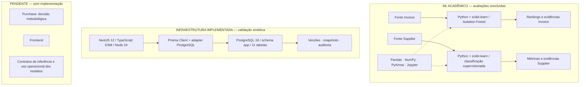

# Detector Inteligente de Anomalias em Compras

**Machine Learning aplicado à análise de faturas e fornecedores, com avaliação acadêmica e infraestrutura de dados rastreável.**

[](https://github.com/MatheusCarriero/detector-anomalias-compras/actions/workflows/quality.yml)
[](https://github.com/MatheusCarriero/detector-anomalias-compras/actions/workflows/backend-quality.yml)


[Modelos e resultados](#modelos-e-resultados) · [Arquitetura](#arquitetura) · [Desenvolvimento](#desenvolvimento) · [Documentação](#documentação)

O projeto estuda três domínios independentes de compras. Invoice Anomaly prioriza faturas incomuns com Isolation Forest. Supplier Risk avalia a classificação fornecida pelo dataset com modelos supervisionados. Purchase Risk permanece em definição metodológica, sem modelo implementado.

A infraestrutura NestJS + Prisma + PostgreSQL já existe. **Os modelos acadêmicos ainda não estão integrados ao backend como serviços de inferência, nem possuem uso operacional validado.**

## Estado atual

| Domínio | Concluído | Pendente |
|---|---|---|
| Invoice Anomaly | 19 features, auditoria, triagem e comparação IF × valor em VALIDATION; avaliação final única em TEST concluída, com validação das fontes e sem fit | Procedência e utilidade humana limitadas; `source_reconciled=false`. Não repetir TEST |
| Supplier Risk | Preparação, EDA TRAIN, baselines/ablações, CV exploratória, configuração LR/C congelada e avaliação final única documentada | Procedência da label/índice, validade externa e eventual uso operacional; não reabrir TEST |
| Purchase Risk | Dataset auditado; unidade em linha de pedido confirmada; decisão C de não implementação registrada | Esclarecer disponibilidade pré-aprovação, semântica e procedência dos campos; feature engineering e modelagem bloqueados pelo gate metodológico |

O backend utiliza TypeScript/ESM, Node 24, NestJS 12 e Prisma 7.10.0. O primeiro incremento PostgreSQL 18 contém 11 tabelas de domínio no schema `app`, com histórico, snapshots e auditoria. A CI offline verifica geração do client, build e testes isolados. As validações conectadas usam um banco sintético e têm execução separada e controlada. O frontend ainda não foi implementado.

## Modelos e resultados

### Invoice Anomaly — priorização para auditoria humana

O **Isolation Forest** produz um ranking de anomalias a partir de 19 features. `is_fraud` é referência de avaliação, não feature; `fraud_type` apoia análises complementares. O score não é probabilidade de fraude nem confirmação de irregularidade.

A avaliação final única de **18/10/2026** utilizou o modelo existente em **60.000 faturas**, sem fit, tuning ou ajuste de threshold. A prevalência da referência `is_fraud` foi de **22,5167%**.

| Orçamento | Estratégia | Precision@K | Captura | Lift |
|---|---|---:|---:|---:|
| 1% | Isolation Forest | 83,00% | 3,69% | 3,6862 |
| 1% | Valor da fatura | 97,83% | 4,34% | 4,3449 |
| 5% | Isolation Forest | 42,77% | 9,50% | 1,8993 |
| 5% | Valor da fatura | 42,37% | 9,41% | 1,8816 |
| 10% | Isolation Forest | 31,97% | 14,20% | 1,4197 |
| 10% | Valor da fatura | 25,02% | 11,11% | 1,1110 |

Valores arredondados para apresentação. Precision@K é a proporção de positivos da referência entre os selecionados; captura é a parcela dos positivos totais recuperada; lift compara essa concentração com a prevalência.

O ranking por valor foi melhor no top 1%. No top 5%, os resultados foram próximos, com pequena vantagem do Isolation Forest; no top 10%, o modelo apresentou maior Precision@K e captura. **Não houve superioridade uniforme**, e a comparação não define sozinha uma política operacional de auditoria.

- [Resultado oficial de TEST](ml/experiments/invoice_test_final_v1.json): registro separado do histórico de VALIDATION.
- [Avaliação histórica](docs/invoice_validation_results.md), [triagem](docs/invoice_validation_results.md#2-triagem-e-diagnóstico-temporal--27092026) e [benchmark IF × valor em VALIDATION](docs/invoice_validation_results.md#3-comparação-if--valor--28092026).
- [EDA das 19 features em TRAIN](docs/invoice_methodological_audit.md#10-eda-acadêmica-somente-train--08102026), [protocolo acadêmico](docs/invoice_academic_evaluation_protocol.md) e [responsabilidades do executor](docs/invoice_academic_evaluation_protocol.md#71-responsabilidades-dos-módulos).

**Limites:** a comparação é retrospectiva e descritiva. A referência `is_fraud` não é verdade empresarial certificada; a procedência do treinamento legado permanece incompleta (`source_reconciled=false`). As agregações usam somente TRAIN, mas todo o período desse conjunto, inclusive a própria observação: não reconstituem o que era conhecido em cada instante. Não houve revisão humana válida nem comprovação de generalização externa ou eficácia empresarial. A [auditoria metodológica](docs/invoice_methodological_audit.md) detalha essas ressalvas.

### Supplier Risk — classificação da referência do dataset

A avaliação acadêmica final selecionou **Logistic Regression, cenário C, com nove features**, após comparação com baseline majoritária, Random Forest e ablações. O pipeline utiliza imputação pela mediana e padronização ajustadas somente em TRAIN.

| Avaliação final | Resultado |
|---|---:|
| Fornecedores em TEST | 3.679 |
| F1-macro | 0,92883 |
| Balanced accuracy | 0,92460 |

Essas métricas medem a reprodução de `Risk_Level`, na convenção `0 = menor risco` e `1 = maior risco`. Não medem previsão de falhas futuras. Uma probabilidade estimada da classe também não é probabilidade real de um problema empresarial.

**Limites:** a origem e a regra da label não foram comprovadas; o índice geopolítico é provisório e associado ao país. A representatividade da fonte limita a generalização. A avaliação foi concluída, mas não foi exportado um modelo de produção.

Consulte o [resultado final](docs/supplier_risk_final_evaluation.md), o [benchmark experimental](docs/supplier_risk_baseline_models.md), a [validação exploratória](docs/supplier_risk_validation_analysis.md) e o [protocolo Supplier](docs/supplier_risk_model.md). As métricas Supplier não devem ser comparadas diretamente às de Invoice: tarefas, populações e referências são diferentes.

### Purchase Risk — não implementado

A decisão vigente é **C: não implementar o modelo ainda**. A fonte possui 5.200 linhas de pedido e 57 colunas; não comprova cabeçalhos de pedido, timestamp de aprovação ou snapshots pré-aprovação.

Não há target nem conjunto de features aprovados para esse uso. Detecção de anomalias é uma possibilidade ainda não escolhida. Semântica de status/contratos, procedência das classificações, ESG simulado e valores em cinco moedas sem conversão precisam ser considerados antes de modelar. Ver [decisão metodológica e pendências](docs/purchase_risk_model.md).

## Arquitetura

### Diagrama de tecnologias

As fontes acadêmicas representam populações diferentes e não têm chaves reais comuns para integração. O diagrama separa os estudos de ML da infraestrutura operacional; não existe fluxo de scoring entre essas camadas nesta entrega.



A CLI, o schema e a migration Prisma ficam na raiz. O backend consome o client compilado para ESM:

```text
prisma/schema.prisma → generated/prisma/ → backend/generated/prisma/ → NestJS
                       TypeScript gerado   JavaScript + declarações
```

Os diretórios gerados não são versionados. O banco utiliza funções SQL transacionais para escrita de entidades versionadas; o CRUD gerado pelo Prisma não substitui esses contratos. Consulte os guias do [backend](backend/README.md) e do [banco](prisma/README.md) antes de qualquer execução conectada.

## Estrutura do repositório

```text
.
├── .github/workflows/          # CI Python e backend offline
├── backend/                    # NestJS, Prisma runtime e testes isolados/conectados
├── prisma/                     # Schema e migration do banco operacional
├── ml/
│   ├── scripts/                # Invoice e ferramentas de preparação/inspeção histórica
│   ├── notebooks/              # EDA Invoice
│   ├── models/                 # Metadata versionada; binário local ignorado
│   ├── experiments/            # Evidências Invoice
│   └── supplier_risk/          # Scripts, notebooks e evidências Supplier
├── tests/                      # Invoice, Supplier e contratos SQL
├── data/                       # Manifestos/metadados; datasets locais ignorados
├── docs/                       # Metodologia, requisitos, resultados e histórico técnico
├── package.json                # Ferramentas Prisma/banco
└── requirements*.txt           # Dependências Python fixadas
```

Purchase e frontend são descritos na documentação; diretórios vazios não representam implementações.

<a id="instalação"></a>

## Desenvolvimento

### Backend e contratos do banco — sem PostgreSQL

Requisitos da CI: Windows x64, Node **24.20.0** e npm **11.14.0**. Os pacotes da raiz e de `backend/` têm lockfiles próprios. Em PowerShell, a partir da raiz:

```powershell
npm.cmd ci --ignore-scripts --no-fund --no-audit
npm.cmd --prefix backend ci --ignore-scripts --no-fund --no-audit
npm.cmd test
npm.cmd run db:validate
npm.cmd --prefix backend run build
npm.cmd --prefix backend test
npm.cmd --prefix backend run test:e2e
npm.cmd --prefix backend run prisma:test
npm.cmd --prefix backend run lint -- scripts/
```

Esses comandos não requerem credenciais, datasets ou PostgreSQL. O build gera e compila o client antes dos testes que o importam. A [CI backend](.github/workflows/backend-quality.yml) também confere dependências e TypeScript, bloqueia configuração de banco e verifica artefatos não ignorados.

**Não use `start`, `db:test` ou `test:runtime:*` como verificação offline.** A aplicação inicia o ciclo real do banco, e os testes conectados exigem ambiente sintético identificado e autorização separada.

### Python e testes científicos sintéticos

A versão está fixada em [`.python-version`](.python-version): **Python 3.14.3**. Use uma venv nova e isolada, sem `--system-site-packages`, e os [requirements de desenvolvimento](requirements-dev.txt). Não sobrescreva automaticamente uma venv existente.

A instalação limpa foi validada em Windows x64. O ambiente local legado já utilizou pacotes externos à venv; igualdade de versões não comprova isolamento. Os pins não garantem reprodução bit a bit dos modelos históricos, que mantêm seus próprios metadados.

Com o ambiente isolado preparado:

```powershell
.\.venv\Scripts\python.exe -I -m pip check
.\.venv\Scripts\python.exe -I -m ruff check . --no-cache
.\.venv\Scripts\python.exe -I -B -m pytest -q -p no:cacheprovider
```

A [CI Python](.github/workflows/quality.yml) descreve a instalação por wheels e as verificações de isolamento. Os testes usam fixtures sintéticas; alguns ajustam modelos artificiais ou executam células com dados sintéticos. Não constituem nova avaliação científica. Dependências opcionais de Jupyter/EDA estão no [manifesto dos notebooks Supplier](ml/supplier_risk/notebooks/requirements.txt).

### Preservação dos dados e resultados

- Não usar TEST para desenvolvimento, debugging, tuning ou exploração. As avaliações finais Invoice e Supplier já foram concluídas e não devem ser repetidas.
- Preservar datasets, modelos, evidências e alterações locais de notebooks. Não sobrescrever resultados nem fabricar evidência ausente.
- Não reprocessar dados reais para verificar pequenas mudanças de código. Manter os três domínios separados.
- Não versionar credenciais, datasets, binários de modelos ou clientes gerados.
- Consultar o [roadmap vigente](docs/implementation_roadmap.md) antes de iniciar outra etapa.

O Invoice tem partições oficiais de 210.000 / 30.000 / 60.000 faturas. O Procurement KPI, com 777 pedidos, é apenas auxiliar e não participa do treinamento dos domínios. As fontes não são necessárias à CI; seu provisionamento está descrito abaixo.

### Fontes e reconstrução

O clone não contém datasets nem modelos binários. As fontes têm populações independentes: IDs semelhantes não autorizam junções, mistura de features ou um score combinado.

| Fonte | Diretório esperado | Uso |
|---|---|---|
| Procurement Invoice Fraud Dataset | `data/raw/` | Invoice; processados existentes em `data/processed/` e modelo legado compatível com `ml/models/model_metadata.json` |
| Supplier Risk Assessment Dataset | `data/external/supplier_risk/` | Preparação descrita em [features](docs/supplier_risk_features.md), [target/split](docs/supplier_risk_target_and_split.md) e no protocolo Supplier |
| Purchase Orders & Supplier Performance Dataset | `data/external/purchase_orders/` | Fonte candidata; decisão C, sem target ou features pré-aprovação aprovados |
| Procurement KPI | `data/auxiliary/` | Fonte opcional, fora dos modelos; o extrator exploratório não integra o clone |

Em provisionamento explicitamente autorizado, crie somente os diretórios necessários e forneça os arquivos das versões correspondentes. Diretórios vazios não são entregas nem exigem execução de pipelines. Os caminhos e contratos dos artefatos estão nos documentos de domínio; não execute produtores apenas para recriar pastas.

Disponibilidade das fontes, licenças e procedência do fit legado não são comprovadas pelo clone. São necessários os arquivos externos corretos, o modelo Invoice compatível com sua metadata e o ambiente fixado. Retreinar não substitui o artefato legado; as avaliações finais concluídas não devem ser repetidas para conferir instalação.

### Controles metodológicos e de manutenção

- Preserve fontes originais e evidências. Identifique domínio, versão, origem, features ordenadas, transformação, partição, parâmetros, seed, ambiente e hashes previstos em cada novo registro autorizado.
- Separe partições antes de aprender transformações; ajuste imputação, scaling e encoding somente em TRAIN. Na CV, ajuste dentro de cada fold. Labels e IDs não entram como features.
- Respeite a disponibilidade temporal das entradas. As agregações retrospectivas atuais não comprovam informações disponíveis antes de cada decisão; Purchase continua bloqueado para modelagem.
- Valide schemas, IDs, alinhamento e compatibilidade antes de scoring; rejeite entradas inválidas e destinos existentes, sem correções silenciosas. Integridade não prova procedência: `source_reconciled=false` permanece no Invoice.
- Preserve os resultados de desenvolvimento separados de TEST. Os contratos de [evidências Supplier](docs/supplier_risk_experiment_records.md) e do [executor Invoice](docs/invoice_academic_evaluation_protocol.md#71-responsabilidades-dos-módulos) continuam públicos.
- Use fixtures sintéticas para manutenção. A preparação histórica não é transacional em todos os produtores; não reprocessar dados para ocultar essa limitação.
- Integração operacional, interfaces, monitoramento e validação de utilidade permanecem sujeitos ao roadmap. Não há SLA, calibração empresarial ou eficácia operacional demonstrada.

Os documentos extensos de estratégia, requisitos e inspeção inicial e seus auxiliares opcionais permanecem apenas no checkout do responsável. O clone usa as instruções e os contratos públicos acima e não depende dessas cópias locais.

## Documentação

| Assunto | Referência |
|---|---|
| Dados, provisionamento e controles | [Fontes e reconstrução](#fontes-e-reconstrução) |
| Metodologia por domínio | [Invoice](docs/invoice_academic_evaluation_protocol.md), [Supplier](docs/supplier_risk_model.md) e [Purchase](docs/purchase_risk_model.md) |
| Estado vigente e decisões anteriores | [Roadmap](docs/implementation_roadmap.md) |
| Integração NestJS/Prisma, CI e validação controlada | [Backend](backend/README.md) |
| Estrutura SQL, funções, permissões e histórico | [Banco operacional](prisma/README.md) |
| Registros de engenharia e validações anteriores | [Registros técnicos consolidados](docs/implementation_roadmap.md#registros-técnicos-consolidados) |

Protocolos, relatórios e JSONs científicos são mantidos separadamente. Os registros técnicos consolidados preservam decisões e verificações de suas épocas; não autorizam repetir avaliações nem substituem o estado vigente.

## Próximas etapas

- Prosseguir com a validação controlada das funções SQL pelo backend e da concorrência, em etapas próprias com dados sintéticos.
- Definir contratos de inferência e requisitos de uso antes de integrar modelos à aplicação.
- Resolver as pendências metodológicas Purchase antes de qualquer feature engineering ou treinamento.
- Implementar interfaces de negócio e frontend somente após definir esses contratos.

A conclusão das avaliações acadêmicas e das verificações sintéticas não equivale a uma implantação de IA em produção.
